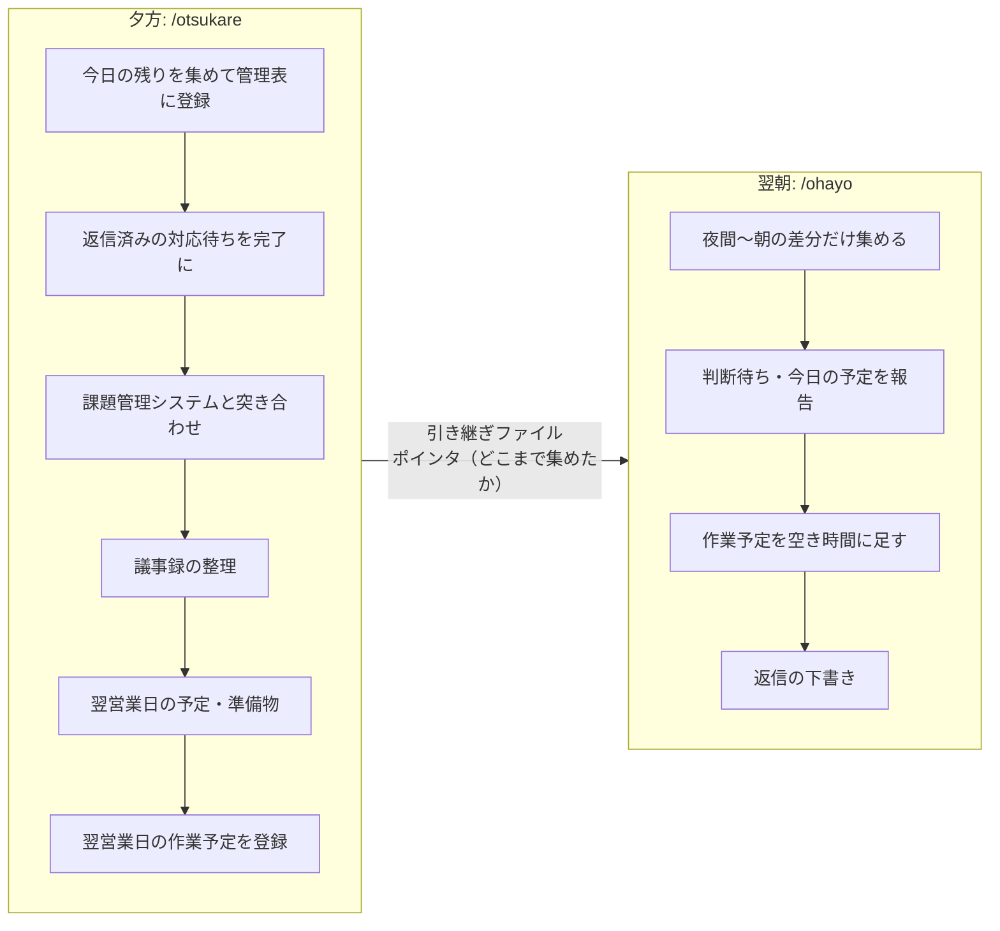

# 朝の振り分けと夕方の締めを Claude Code に任せる: ohayo / otsukare

毎日のチャット・メール・会議の議事録から「自分がやること」を拾い、手元の管理表にためておく。朝はその振り分け、夕方は締めと翌日の段取りまでを、Claude Code のスキルにした話です。

## 1. 何を作ったか

2つのコマンドです。

| コマンド | タイミング | 役割 |
|---|---|---|
| `/ohayo` | 朝 | 前回の収集以降の差分を集め、今日の予定・判断待ち・作業予定を報告する |
| `/otsukare` | 退勤前 | 今日の残りを集めて登録し、翌営業日の準備をして、翌朝に引き継ぐ |

扱う情報源は次のとおりです。特定のサービスに依存しない書き方にしています。

- チャット（自分宛てのメッセージ、メンション、自分が「対応します」と言った発言）
- メール（受信と、自分が約束したことが書かれた送信）
- 会議の議事録（アクションアイテム）
- 予定表
- 課題管理システム（自分の担当課題の状況）
- 手元管理用の表（データベース型のノートツールでも、表計算ファイルでもよい）

## 2. 経緯: 最初は朝の1本だけだった

最初にあったのは、朝に1回走らせる `daily-inbox` だけでした。チャット・メール・議事録から依頼を洗い出し、手元の管理表に登録します。

使ううちに、困ったことが2つ出てきました。

1. **朝が重い。** 前日の分も含めて集めるので、毎朝の処理が長い。月曜は土日をまたぐため、読む量が特に多い。
2. **1日の終わりに区切りがない。** 今日の作業を忘れていないか、返信待ちのまま残っていないかを、確認する場所がない。

そこで、夕方に走らせる `daily-close` を足しました。

- 夕方のうちに今日の分を集めて登録しておく。翌朝は夜間から朝までの**差分だけ**を見ればよくなり、朝が速くなる。
- 今日の終わりに、返信待ちの確認、課題管理システムとの突き合わせ、議事録の整理をして、**忘れがないか確かめる**。
- 翌営業日の予定と準備物、作業予定まで先に用意する。

夕方に実行しなかった日は、朝が従来どおり全部の手順を行います。夕方の実行は任意で、朝だけでも完結します。

## 3. 名前の由来

最初は `daily-inbox` と `daily-close` という名前でしたが、毎日打つので短くしました。名前は、次のページを参考にしています。

- https://docs.kani.show/oedo11/#16

朝は `/ohayo`、夕方は `/otsukare`。日本語の挨拶にしたのは、打つのが苦にならず、朝と夕方の対になっていることが一目で分かるからです。

## 4. なぜ自作したか: 「見せる」だけでなく「書き込む」まで

Claude には、朝の予定や情報をまとめて見せてくれる標準の仕組み（morning）があります。ただ、あれは**参照して見せるだけ**です。

自分がほしかったのは、見せるところから一歩進んで、次の3点でした。

1. 拾った依頼を管理表に**登録する**（重複は除く）
2. 返事が済んだ対応待ちを**完了にする**
3. 作業予定を予定表に**書き込む**

見せるだけだと、読んだあとに自分で転記する手間が残ります。書き込みまで任せると、朝と夕方の作業が「確認して OK を出す」だけになります。

一方、書き込みは影響が大きいので、歯止めも一緒に設計しました（第7章）。

## 5. 1日の流れ

つなぎは2つです。

- **ポインタ**: 情報源ごとの「ここまで集めた」時刻。同じメッセージを二度読まないために持つ。
- **引き継ぎファイル**: 夕方が書き、翌朝が読む Markdown。翌日の予定と準備物、朝に本人が決めること（判断待ち）、夜に予定表へ入れなかった作業候補などを書く。

役割分担は次のとおりです。

- 夕方: その日の**後始末と明日の段取り**。
- 朝: 夜間の**差分と判断**。

## 6. 中身の工夫

### 6.1 集めるところはサブエージェントに任せる
チャットやメールの検索結果は大きく、月曜は特に膨らみます。本体の会話に残すと、あとの作業に使える余地が減ります。そこで、情報源ごとのサブエージェント（軽いモデル）を並列に走らせ、本体は結果の JSON だけ受け取ります。

### 6.2 担当を「自分」「共同」「他者」に分ける
複数人宛ての依頼を、まるごと自分の担当にしないためです。連名の依頼は「共同」にして、自分の分担が読み取れるときだけメモに書きます。議事録のアクションも、担当が自分だと書かれているものだけ「自分」にし、担当が書かれていないものは登録せず報告に回します。

### 6.3 課題管理システムには自動で起票しない
拾った依頼は、まず手元の管理表に「未確認」として登録します。人が内容を見て、起票するものだけ別のコマンドで課題管理システムに送ります。課題管理システムの本文は管理表にコピーしません（本文にパスワードなどが書かれていることがあるため）。

### 6.4 「処理済み」は期限切れに入れない
課題管理システムの「処理済み」を、作業は終わっていて報告待ち、と運用している場合があります。期限切れの判定は「未対応・処理中」だけにして、処理済みは「報告待ち」として分けて出します。自動で完了にもしません。

### 6.5 作業予定は空き時間に割り当てる
今日やる作業を優先順に並べ、予定表の空きに割り当てます。1枠は最大90分で、工数は15分単位の「目安」です。夕方に翌日分を入れるときは、朝に空けておく時間を残し、空きの6割までにします。夜間に届く急ぎの連絡を、朝の差分で入れられるようにするためです。

## 7. 決めごと・歯止め

書き込みを任せる以上、決めごとを先に置いています。

| 決めごと | 理由・補足 |
|---|---|
| メール・チャットは**送らない**。下書きまで | 取り返しがつかない操作は人が行う |
| 課題管理システムに**起票しない** | 人が管理表で確認してから別コマンドで起票する |
| 予定表への登録は、**一覧を見せて OK をもらってから** | 質問文の中に「時間 → 作業」を1件ずつ番号付きで入れる。ダイアログの表示中は直前のチャット出力が見えないため |
| 夕方に聞くのは「はい／いいえ」だけ | 退勤前は確認が雑になりやすい。内容を読んで決めることは、引き継ぎの「判断待ち」に書いて朝に回す |
| 確認していない項目を「なし」と報告しない | 夕方に済ませた手順を朝に省いたときは「昨夜の締めで実施済み」と書く |
| 古いポインタは自動でさかのぼらない | 数日分を集めるとトークンが非常に大きくなる。見ていない期間を報告に書く |
| 例外: 内容のない議事録ページは確認なしでゴミ箱へ | 自分が作ったページに限る。自動で消すことを事前に了承済み |

## 8. 設定を分けた理由

人によって、情報源の組み合わせや保存先、予定表への登録方法が違うので、個人差は設定ファイルに出しました。

- 保存先: オンラインのデータベース、または手元の表計算ファイル
- 除外する送信元、「報告だけにする」通知、「週1回まとめて対応する」もの
- 作業時間、予定表の登録方法
- 夕方の締めの細かい値（翌日の作業予定を夜に登録するか、朝に空けておく時間、引き継ぎの保存日数）

## 9. 作業を別の場所に出す（おまけ）

朝の報告が終わったあと、ターミナルのタブ管理ツールで、今日の作業ごとに別タブを作る運用につなげています。メインのタブは「振り分けと指示出し」に専念し、作業は1作業1タブにして、タブの名前を作業名にします。タブが残っている間は未完了、閉じるのは自分が「完了」と言ったときだけ、というルールです。1日に1回しか作らないように、記録ファイルで歯止めをかけています。

## 10. 実行環境の話: Windows である意味がなくなってきた

実行している環境は、Windows Terminal から WSL（Windows 上の Linux）を起動し、その中でタブ管理ツール（herdr）経由で Claude Code を動かす、という形です。

使っていくうちに、「これは Windows である意義を失っているのでは」と感じるようになりました。

- 日々の作業の大半が、WSL の中のターミナルで完結している。
- Windows 側にしかないものは、予定表やメールのような、Windows 固有のアプリに頼る部分くらいになっている。しかもそれらは、コネクタ経由（アプリの画面を使わない形）で扱えている。
- Windows と WSL でファイルの置き場所や設定フォルダが別になり、パスの読み替えや、設定が二重になる手間が出ている。

そのため、「Mac でいいのでは」と考えています。ターミナルがそのまま Unix 環境で、WSL のような二重構造がなく、同じ手順を素直に動かせるからです。

ただし、今のところは考えているだけで、移行はしていません。移すかどうかは、Windows 側に残っている依存（社内システムや、Windows 前提のアプリなど）がどれだけあるかを洗い出してから決めるつもりです。

## 11. やってみて気づいたこと

- 朝の差分モードは、夕方の実行がないと効きません。夕方の実行をどれだけ習慣にできるかが、朝の速さを決めます。
- 引き継ぎファイルに「判断待ち」を全件並べると、件数が増えたときに新しいものが埋もれます。新規と放置分だけ件名を出し、残りは件数にする工夫が要りそうです。
- 手順を2つのスキルで共有すると、番号の付け方や古い記述が残りやすくなります。使わなくなった登録方法の説明は、分けて置くほうが読みやすくなります。
- 「ユーザーの指摘をメモリに残す」だけでなく、**スキル本体も直す**ことが必要でした。メモリだけだと、同じ指摘が再発しました。

## 12. 参考

- 名前の参考: https://docs.kani.show/oedo11/#16
